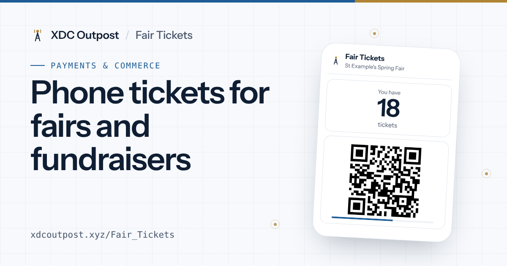

# Fair Tickets

**Phone tickets for school fetes, fairs and fundraisers.**

Families buy tickets at the booth with cash or card, then show a code on their phone at any stall. No paper tickets, no counting at the end of the day, and exact totals for every booth and stall.

**Start here: [xdcoutpost.xyz/Fair_Tickets](https://xdcoutpost.xyz/Fair_Tickets/)**

## How it works

1. **Buy tickets at the booth.** Families pay with cash or card as usual. The booth taps the amount and scans the family's phone.
2. **Show your code at stalls.** The stall scans the code on the family's phone. A big green tick means it's paid.
3. **Watch your tickets.** Every family sees how many tickets they have left and where they spent them.

## Why people like it

- **No paper.** No rolls of tickets printed, torn and thrown away.
- **Low energy.** Runs on a low-energy database network, designed from the start to be eco-friendly.
- **Volunteers home sooner.** Every booth and stall total is already added up.
- **Totals you can trust.** Every ticket is recorded and can't be changed afterwards.
- **Less cash at stalls.** Cash and card stay at the ticket booth.
- **School spirit.** House or class leaderboards on a big screen, live during the day.
- **Private.** No names, emails or phone numbers needed from families.
- **Free.** No subscriptions, no per-ticket fees, no app download.

## The apps

| App | For | Link |
| --- | --- | --- |
| Fair Organiser | Setting up and running the fair | [Open](https://xdcoutpost.xyz/Fair_Tickets/organiser/) |
| Ticket Booth | Selling tickets | Sent by the organiser |
| Fair Stall | Taking tickets at a stall | Sent by the organiser |
| Fair Tickets | Families | Sent by the organiser, or scan the fair's poster |
| Live tally | A TV or monitor at the fair | From the organiser's dashboard |

Each fair travels in its own links, so nothing needs installing or configuring. Every app works in the phone's browser and can be added to the home screen.

Want to try it first? Open a **[practice fair](https://xdcoutpost.xyz/Fair_Tickets/organiser/?net=test)**: it works exactly the same, with pretend tickets.

## Running your own event?

It's super simple, and we're happy to help you set up. Get in touch through the **[XDC Outpost contact page](https://xdcoutpost.xyz/#contact)**.

---

Built by [XDC Outpost](https://xdcoutpost.xyz). Free to use under the [Terms of Use](https://xdcoutpost.xyz/Fair_Tickets/terms.html). MIT licence. Provided as is, without warranty. Built and run independently; not operated by the XDC Foundation or XinFin.
